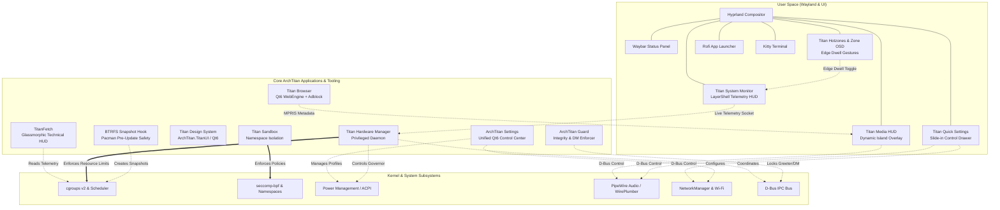
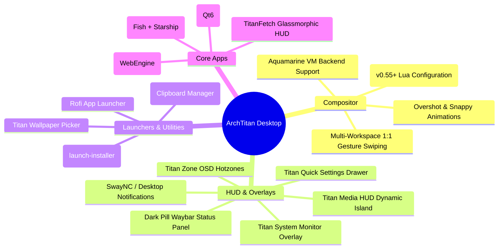
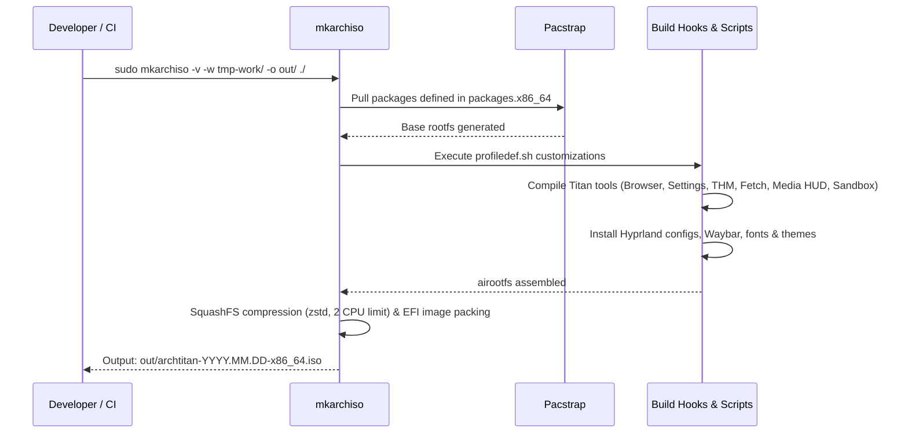

#  ArchTitan OS

[](https://archlinux.org/)
[-00C8FF?logo=wayland&logoColor=white)](https://hyprland.org/)
[](https://www.qt.io/)
[](https://github.com/catppuccin/catppuccin)
[](LICENSE)

ArchTitan is a custom, high-performance Linux distribution built on top of Arch Linux. Designed around the modern Wayland ecosystem, it offers a deeply integrated, aesthetically pleasing, and resource-efficient environment tailored for power users, developers, and enthusiasts.

---

##  Core Philosophy

ArchTitan embraces the Unix philosophy while providing a cohesive, pre-configured premium experience out of the box.

- **Wayland Native:** Powered by the **Hyprland** dynamic tiling window manager with fluid animations, 1:1 touchpad relative workspace gestures, pointer hotzones, and responsive window rules.
- **Resource Aware:** Features custom daemons like the **Titan Hardware Manager (THM v3.1)** and **Titan System Monitor (`titan-sysmon`)** for deterministic system-level resource orchestration and live telemetry streaming.
- **Aesthetic First:** Deeply integrated **Catppuccin Mocha** dark theme and unified **Titan Design Language (TDL)** across all UI elements, terminals, browsers, overlays, and custom tools.
- **Privacy & Security Focused:** Process sandboxing via Linux namespaces & seccomp-bpf, plus native ad & tracker blocking in Titan Browser.
- **System Safety:** Automated BTRFS pre-transaction snapshots before `pacman` updates with bootable subvolume rollback entries in GRUB, alongside **ArchTitan Guard** display manager integrity protection.
- **Developer Ready:** Ships with modern CLI utilities, an optimized `fish` + `starship` shell experience, PipeWire audio, and Qt6 development toolchains.

---

##  Design System (Titan Design Language)

Every surface shares a single design system — the **Titan Design Language (TDL)** — living in [`titan-ui/`](titan-ui/README.md): Catppuccin Mocha surfaces, Samsung One UI 9.0 geometry, a wallpaper-adaptive accent, and a full component set (`TitanButton`, `TitanCard`, `TitanToggleTile`, `TitanSpinner`, `TitanEmptyState`, `TitanErrorState`, …).

- **One source of truth:** QML apps import `ArchTitan.TitanUI`; Qt Widgets apps use the header-only `TitanPalette.h`. Hardcoded colour literals are disallowed outside the token set.
- **Enforced in CI:** palette lint, config-tree drift and WCAG 2.1 contrast checks run on every change (`.github/workflows/ui-consistency.yml`).
- **Preview:** `cd titan-ui && ./build.sh && QML_IMPORT_PATH=build/qml ./build/titan-ui-gallery`.

---

##  System Architecture

ArchTitan bridges the gap between the modern Wayland compositor, custom middleware, and low-level Linux kernel subsystems:




ArchTitan provides a suite of native C++ and Qt6 applications built specifically for the OS:

### 1.  Titan Hardware Manager (`titan-hwm`)
* **Lead:** `@GitGuru29` | **Location:** `titan-hwm-v3/` & `subsystems/titan-hwm/`
* High-performance C++20 autonomous resource orchestrator running as `titan-hwm.service` with `archtitan.slice` cgroup v2 delegation (`OOMScoreAdjust=-1000`).
* Dynamically routes workloads across `archtitan-active.slice`, `archtitan-background.slice`, `archtitan-idle.slice`, and `archtitan-reclaimable.slice` based on multi-signal fusion classification (process trees, Hyprland window/workspace focus, CWD project signatures, and cmdline drift).
* Features 10-hour stress-tested resilience: atomic `pidfd`-based reclaim signaling, `posix_spawn()` execution, 2-second workspace leave hysteresis, browser-safe cgroup freezing, first-class VM & database service immunity, and automated orphan thaw sweep.

### 2.  ArchTitan Settings (`archtitan-settings`)
* **Lead:** `@GitGuru29` | **Location:** `archtitan-settings/`
* Unified C++/Qt system control center featuring:
  - **Appearance:** Theme toggle, Catppuccin Mocha presets, panel opacity, icon sets.
  - **Display:** Brightness, Night Light (`wlsunset`), resolution, and scaling.
  - **Audio:** Output/input volume, live PipeWire audio profile controls.
  - **Power Management:** Universal stateful power profile cycling (**Power Saver** ➔ **Balanced** ➔ **Performance** via `Super + P` / `Fn + P`).
  - **Network & Security:** NetworkManager Wi-Fi scanner, Titan Sandbox status, screen autolock, and firewall inspection.

### 3.  Titan Browser (`titanbrowser`)
* **Lead:** `@GitGuru29` | **Location:** `titan-browser-source/`
* Fast, lightweight first-party web browser built on **Qt6 WebEngine** with native Wayland rendering:
  - Glassmorphic UI matching the system-wide Catppuccin Mocha aesthetic.
  - Multi-tab management, smart URL/search bar, default system browser bound to `<kbd>Super</kbd> + <kbd>W</kbd>`.
  - Built-in network-level & DOM ad-blocker optimized for streaming without player stalls.
  - Sandboxed launch via `titan-exec-hook` under `/etc/titan-sandbox/policies/browser.toml`.

### 4.  Titan Sandbox (`titan-sandboxd`)
* **Lead:** `@GitGuru29` | **Location:** `sandbox/` & `subsystems/titan-sandbox/`
* Fine-grained application isolation engine using Linux user/mount/PID/network namespaces, seccomp-bpf syscall filtering, and capability drops configured via declarative TOML policy files.

### 5.  Titan Media HUD (`titan-media-hud`)
* **Lead:** `@GitGuru29` | **Location:** `subsystems/titan-media-hud/`
* Modern "Dynamic Island" style QML overlay and Waybar center module integration:
  - Interactive center capsule in Waybar with click-to-expand trigger.
  - Features MPRIS media playback controls, GPU telemetry (`titan-hud-gpu`), system context (`titan-hud-context`), and custom power menu (`titan-powermenu`).

### 6.  TitanFetch (`titanfetch`)
* **Lead:** `@GitGuru29` | **Location:** `titanfetch-src/` & `subsystems/titan-fetch/`
* High-performance C++/Qt6 system information utility:
  - Terminal CLI mode (`titanfetch`) with sub-millisecond execution.
  - Interactive **Glassmorphic Technical HUD** (`titanfetch --gui`) featuring real-time per-core CPU load, live RAM/Swap gauges, active THM profile indicator, and quick system actions.

### 7.  BTRFS Automatic Snapshot Hook
* **Lead:** `@GitGuru29` | **Location:** `airootfs/etc/pacman.d/hooks/` & `airootfs/usr/local/bin/archtitan-btrfs-snapshot`
* Automated pre-transaction safety hook creating timestamped read-only BTRFS root subvolume snapshots (`/.snapshots/@pre-pacman-YYYYMMDD-HHMMSS`) before `pacman` updates, with automatic 10-snapshot retention rotation and bootable rollback menu entries in GRUB via `grub-btrfs`.

### 8.  Titan System Monitor (`titan-sysmon`)
* **Lead:** `@GitGuru29` | **Location:** `subsystems/titan-sysmon/`
* Hardware-accelerated Wayland LayerShell telemetry dashboard and overlay built in C++20/Qt6:
  - Streams real-time kernel & hardware metrics directly from THM v3's UNIX telemetry socket (`/run/titan-hwm/telemetry.sock`).
  - Features smooth animated `GaugeRing` indicators for CPU/Memory, per-core utilization sparklines, and GPU performance telemetry (AMD, NVIDIA, Intel).
  - Displays dynamic THM workload tier allocation across `archtitan-active.slice`, `archtitan-background.slice`, `archtitan-idle.slice`, and `archtitan-reclaimable.slice`.
  - Toggled instantly via left-center screen hotzone dwell or command-line toggle (`titan-sysmon --toggle`).

### 9.  Titan Hotzones & Zone OSD (`titan-hotzones`)
* **Lead:** `@GitGuru29` | **Location:** `subsystems/titan-hotzones/`
* Screen edge and corner cursor dwelling daemon paired with an input-transparent Wayland LayerShell HUD overlay (`titan-zone-osd`):
  - Tracks pointer dwell across seven screen zones (corners and edge midpoints) without high polling overhead (~30 Hz active, 5 Hz idle).
  - Built-in dwell timing (250ms default), exclusion box hysteresis ("paper trail" re-arm rule), cooldown limits, and fullscreen window inhibition.
  - Features a smooth radial progress ring OSD visualizing dwell progress before actions trigger.
  - Ships configured (`/etc/archtitan/hotzones.toml`) to trigger `titan-sysmon --toggle` on left-center dwell, workspace switching, and corner utilities.

### 10.  Titan Quick Settings & Notification Drawer (`titan-quicksettings`)
* **Lead:** `@GitGuru29` | **Location:** `subsystems/titan-quicksettings/`
* Obsidian glassmorphic slide-out control drawer and notification center sliding in from the right edge on `<kbd>Super</kbd> + <kbd>N</kbd>`:
  - Adheres to the unified Titan Design Language (TDL) with Samsung One UI 9.0 geometry and Catppuccin Mocha glass styling.
  - Interactive header showing live system uptime (`/proc/uptime`), settings shortcut, and power actions.
  - Quick toggle rows: NetworkManager Wi-Fi, BlueZ Bluetooth, Caffeine mode, PipeWire microphone & audio mute, Hyprsunset Night Light, Grim screenshot area snip, and ambient tools.
  - Live desktop notification center card list with DND toggle, unread counter, and bulk clear.

### 11.  Titan Wallpaper Picker (`titan-wallpaper-picker`)
* **Lead:** `@GitGuru29` | **Location:** `subsystems/titan-wallpaper-picker/`
* Interactive wallpaper selection utility bound to `<kbd>Super</kbd> + <kbd>\\</kbd>`:
  - Grid-based visual browser for system and user wallpapers.
  - Integrates with `titan-wallpaper-restore` to persist chosen wallpapers across sessions and Hyprland reloads.

### 12.  ArchTitan Guard (`archtitan-guard`)
* **Lead:** `@GitGuru29` | **Location:** `subsystems/archtitan-guard/`
* Hardened display manager and pacman transaction integrity guard:
  - Intercepts package operations to prevent conflicting display managers or removal of core greeter components (`sddm-rise-theme`).
  - Ensures seamless SDDM and Hyprland startup across live and installed environments.

### 13. 📱 TITAN Share (`titanshare-daemon`)
* **Lead:** Teammate | **Location:** `subsystems/titan-share/`
* Cross-platform peer-to-peer file sharing subsystem comprising a C++ mDNS Linux daemon and Jetpack Compose Android client:
  - Dynamic path resolution: Root execution (`/var/lib/titanshare`), User (`~/.local/share/titanshare`), Fallback (`/tmp/titanshare`).
  - Path traversal sanitization for received files and dedicated send staging folder (`send_to_android/`).
  - Hardened systemd sandboxing (`ProtectSystem=strict`, `StateDirectory=titanshare`) with IPC pairing PIN output at `/run/titanshare/titanshare-pin.json`.
  - Registered in THM v3.1 `ProtectedRegistry` to prevent freeze or OOM reclaim during active file transfers.

### 14. 🚧 TitanFocus (`titan-focus`) — *Proposed*
* **Lead:** `@GitGuru29` | **Location:** `subsystems/titan-focus/` *(not yet created)*
* **Status:** 🚧 Design proposal only — no code implemented. Review the plan before contributing.
* Developer work optimization engine, extending THM's existing fusion classifier from machine-resource orchestration to human-attention orchestration:
  - Advisory-only by design: observes and suggests, never signals, throttles, or suspends a process.
  - 12-rule nudge engine (hydration, 20-20-20 eye strain, posture, focus blocks, context-switch thrash, long builds, agent completion, thermal pressure).
  - Zero-cost presence detection via Wayland `ext-idle-notify-v1` v2 — no camera, no sensors, no polling loop.
  - Reuses THM's classifier vocabulary from `/etc/titan-hwm/config` for developer-context signals.

### 15. 🚧 Additional Subsystems (In Development)
* **Auto GPU Switcher** (`subsystems/auto-gpu-switcher/`): Intelligent iGPU/dGPU dynamic switching.
* **TITAN AI** (`subsystems/titan-ai/`): Context-aware developer assistant.
* **TITAN Task Manager** (`subsystems/titan-task-manager/`): Advanced scheduling and resource tracking.
* **TITAN Mirror** (`subsystems/titan-mirror/`): Wayland-native screen mirroring for mobile devices.
* **TitanFocus** (`subsystems/titan-focus/`): 🚧 Developer work optimization engine — *proposal only, not yet implemented*.

---

##  Desktop Environment & Keybindings

ArchTitan uses an optimized Hyprland desktop with smooth bezier curves, subtle drop shadows, and responsive window grouping.



###  Essential Keybindings

| Shortcut | Action | Description |
| :--- | :--- | :--- |
| <kbd>Super</kbd> / <kbd>Super</kbd> + <kbd>Space</kbd> | App Launcher | Launches Rofi application menu |
| <kbd>Super</kbd> + <kbd>N</kbd> | Quick Settings | Slides out Quick Settings & Notification drawer (`titan-quicksettings`) |
| <kbd>Super</kbd> + <kbd>M</kbd> | Media HUD | Toggles Dynamic Island media overlay (`titan-media-hud --toggle`) |
| <kbd>Super</kbd> + <kbd>\\</kbd> / <kbd>Super</kbd> + <kbd>Shift</kbd> + <kbd>\\</kbd> | Wallpaper Picker | Opens grid-based wallpaper selector (`titan-wallpaper-picker`) |
| <kbd>Super</kbd> + <kbd>Return</kbd> | Terminal | Opens Kitty terminal with Fish shell |
| <kbd>Super</kbd> + <kbd>W</kbd> | Titan Browser | Launches first-party sandboxed TitanBrowser |
| <kbd>Super</kbd> + <kbd>,</kbd> | ArchTitan Settings | Opens unified System Settings panel |
| <kbd>Super</kbd> + <kbd>E</kbd> | File Manager | Opens Ranger terminal file manager |
| <kbd>Super</kbd> + <kbd>P</kbd> / <kbd>Fn</kbd> + <kbd>P</kbd> | Power Profile Toggle | Cycles system power profiles (Power Saver ➔ Balanced ➔ Performance) |
| <kbd>Super</kbd> + <kbd>V</kbd> | Clipboard History | Opens clipboard history picker (`cliphist` + `rofi`) |
| <kbd>Super</kbd> + <kbd>Shift</kbd> + <kbd>S</kbd> / <kbd>Print</kbd> | Screenshot | Area snip copied to clipboard (`grim` + `slurp`) |
| <kbd>Ctrl</kbd> + <kbd>Super</kbd> + <kbd>V</kbd> | Volume Mixer | Launches PipeWire volume control (`pavucontrol`) |
| <kbd>Ctrl</kbd> + <kbd>Shift</kbd> + <kbd>Esc</kbd> | Task Manager | Launches terminal task monitor (`btop`) |
| <kbd>Super</kbd> + <kbd>L</kbd> | Lock Screen | Locks session with Catppuccin glass theme (`hyprlock`) |
| <kbd>Super</kbd> + <kbd>Shift</kbd> + <kbd>L</kbd> | Suspend | Suspends system to RAM |
| <kbd>Super</kbd> + <kbd>Q</kbd> | Close Window | Closes active window |
| <kbd>Super</kbd> + <kbd>F</kbd> | Fullscreen | Toggles fullscreen mode |
| <kbd>Super</kbd> + <kbd>D</kbd> | Maximize | Toggles maximized mode with gaps |
| <kbd>Super</kbd> + <kbd>I</kbd> | System Installer | Launches Calamares on live media / Settings on installed OS |
| <kbd>Ctrl</kbd> + <kbd>Alt</kbd> + <kbd>Delete</kbd> | Power Menu | Opens Titan Power Menu overlay |

### 👆 Touchpad Gestures & Pointer Hot-Zones

| Interaction | Trigger | Action |
| :--- | :--- | :--- |
| **Touchpad 3-Finger / 4-Finger Horizontal** | Swipe Left / Right | 1:1 discrete relative workspace stepping (`r+1` / `r-1`) |
| **Touchpad 3-Finger Down** | Swipe Down | Closes active window |
| **Touchpad 3-Finger Up** | Swipe Up | Opens App Launcher menu |
| **Touchpad 4-Finger Up** | Swipe Up | Toggles special scratchpad workspace (`magic`) |
| **Hotzone Left Edge Midpoint** | Pointer Dwell (250ms) | Toggles Titan System Monitor overlay (`titan-sysmon --toggle`) |
| **Hotzone OSD Feedback** | Screen Edge / Corner | Displays radial dwell countdown ring before action fires |

---

##  Building the Live ISO

ArchTitan is built using the official Arch Linux `archiso` suite.

### Prerequisites

An Arch Linux host system with `archiso`, `base-devel`, `cmake`, `qt6-base`, and `qt6-webengine` installed:
```bash
sudo pacman -S archiso git base-devel cmake qt6-base qt6-webengine
```

### Build Workflow



### Build Commands

```bash
# Clone the repository
git clone https://github.com/GitGuru29/archtitan-os.git
cd archtitan-os

# Clean previous build artifacts
sudo rm -rf tmp-work out

# Build the ISO
sudo mkarchiso -v -w tmp-work/ -o out/ ./
```

The generated `.iso` will be placed in the `out/` directory.

---

##  Installation & Testing

### 1. Bare Metal Installation
1. Flash the generated ISO to a USB flash drive using `dd`, BalenaEtcher, or Rufus:
   ```bash
   sudo dd if=out/archtitan-*.iso of=/dev/sdX bs=4M status=progress oflag=sync
   ```
2. Boot the target machine in **UEFI mode** (disable Secure Boot).
3. On the live desktop, launch the **Calamares Graphical Installer** (<kbd>Super</kbd> + <kbd>I</kbd>).
4. Follow the step-by-step partition and user setup wizards to complete the installation.

### 2. QEMU / KVM Quick Runner
Use the bundled `run-vm.sh` script (with ISO auto-detection in `out/` or `Downloads/`) to test live or installed builds in QEMU:

```bash
# Boot the live ISO
./run-vm.sh

# Boot from installed qcow2 virtual disk
./run-vm.sh --disk

# Wipe disk and perform fresh reinstall
./run-vm.sh --fresh
```

### 3. VirtualBox Configuration
When testing inside VirtualBox, ensure the following VM settings are enabled to support Wayland:
- **System ➔ Motherboard:** Check `Enable EFI (special OSes only)`
- **Display ➔ Screen:** Video Memory = `128 MB`, Graphics Controller = `VMSVGA`
- **Display ➔ Screen:** Check `Enable 3D Acceleration`

---

##  Team Structure & Subsystem Ownership

ArchTitan is developed as a modular group project with 4 members. The repository is organized into core OS components at the root and dedicated subsystem packages in `subsystems/`.

### Core OS Components vs. Subsystems

| Component | Category | Owner | Status | Directory |
| :--- | :--- | :--- | :--- | :--- |
| **Titan Hardware Manager** | Core Daemon | @GitGuru29 (Lead) | 🟢 Shipped (v3.1) | `titan-hwm-v3/` & `subsystems/titan-hwm/` |
| **ArchTitan Settings** | Core App | @GitGuru29 (Lead) | 🟢 Shipped | `archtitan-settings/` |
| **Titan Browser** | Core App | @GitGuru29 (Lead) | 🟢 Shipped | `titan-browser-source/` |
| **Titan Sandbox** | Core Subsystem | @GitGuru29 (Lead) | 🟢 Shipped | `sandbox/` & `subsystems/titan-sandbox/` |
| **TitanFetch** | Core Utility | @GitGuru29 (Lead) | 🟢 Shipped | `titanfetch-src/` & `subsystems/titan-fetch/` |
| **Titan Media HUD** | Companion App | @GitGuru29 (Lead) | 🟢 Shipped | `subsystems/titan-media-hud/` |
| **Titan System Monitor** | System Overlay | @GitGuru29 (Lead) | 🟢 Shipped | `subsystems/titan-sysmon/` |
| **Titan Hotzones & Zone OSD** | Interaction Daemon | @GitGuru29 (Lead) | 🟢 Shipped | `subsystems/titan-hotzones/` |
| **Titan Quick Settings** | Desktop Drawer | @GitGuru29 (Lead) | 🟢 Shipped | `subsystems/titan-quicksettings/` |
| **Titan Design Language (TDL)** | UI Library | @GitGuru29 (Lead) | 🟢 Shipped | `titan-ui/` |
| **Titan Wallpaper Picker** | Desktop Utility | @GitGuru29 (Lead) | 🟢 Shipped | `subsystems/titan-wallpaper-picker/` |
| **ArchTitan Guard** | Security Enforcer | @GitGuru29 (Lead) | 🟢 Shipped | `subsystems/archtitan-guard/` |
| **BTRFS Snapshot Hook** | Safety Feature | @GitGuru29 (Lead) | 🟢 Shipped | `airootfs/etc/pacman.d/hooks/` |
| **Auto GPU Switcher** | Subsystem | @GitGuru29 (Lead) | 🟡 In Dev | `subsystems/auto-gpu-switcher/` |
| **TITAN AI** | Subsystem | Teammate | 🟡 In Dev | `subsystems/titan-ai/` |
| **TITAN Task Manager** | Subsystem | Teammate | 🟡 In Dev | `subsystems/titan-task-manager/` |
| **TITAN Share** | Subsystem | Teammate | 🟡 In Dev | `subsystems/titan-share/` |
| **TITAN Mirror** | Subsystem | Teammate | 🟡 In Dev | `subsystems/titan-mirror/` |

---

## 🚨 Repository Rules & Contribution Guidelines

> **⚠️ All team members must review and adhere to these guidelines before submitting changes.**

### 🔒 Branch Protection & Pull Requests

- The `main` branch is protected. Direct commits are restricted.
- All contributions must be submitted via a **Pull Request (PR)** targeting `main`.
- PRs require at least **1 review and approval** from `@GitGuru29` before merging.
- Contributors must work exclusively within their assigned `subsystems/<name>/` directories.

### 🛡️ Protected OS Core Files (`CODEOWNERS`)

Changes affecting base OS configurations and core tooling require explicit review by `@GitGuru29`:

| Protected Path | Purpose |
| :--- | :--- |
| `airootfs/` | Rootfs overlay (systemd units, dotfiles, desktop configs, binary overlays) |
| `archtitan-settings/` | ArchTitan Settings application source |
| `titan-browser-source/` | Titan Browser source and resources |
| `titan-hwm-v3/` | Titan Hardware Manager v3 C++20 daemon source |
| `titanfetch-src/` | TitanFetch utility source |
| `titan-ui/` | Titan Design Language (TDL) component library & tokens |
| `sandbox/` | Titan Sandbox daemon & policy parser source |
| `subsystems/titan-hotzones/` | Hot-zone pointer dwell daemon & Zone OSD source |
| `subsystems/titan-sysmon/` | System Monitor layer-shell overlay source |
| `subsystems/titan-quicksettings/` | Quick Settings & notification drawer source |
| `efiboot/` & `grub/` | EFI & GRUB bootloader configurations |
| `packages.x86_64` | Package manifest for live ISO generation |
| `pacman.conf` | Pacman package manager and custom repository configuration |
| `profiledef.sh` | Archiso build profile definitions and permissions |
| `install.sh` & `run-vm.sh` | Host installer and QEMU virtual test harness |
| `.github/` | CI/CD automation workflows and repository governance |

### 🏷️ Commit Message Format

```
<type>(<scope>): <short description>

Examples:
  feat(titan-browser): add native Qt6 directory picker for download location
  fix(settings): implement universal power profile cycling hotkey
  feat(titan-media-hud): add async album art caching and MPRIS seeker
  docs(readme): update system architecture and core components guide
```

---

##  Documentation & Resources

Comprehensive guides and technical documentation are available on the [ArchTitan OS Wiki](https://github.com/GitGuru29/archtitan-os/wiki):

| Topic | Description | Link |
| :--- | :--- | :--- |
| **System Architecture** | Subsystem layers, D-Bus IPC, and kernel interfaces | [Architecture Guide](https://github.com/GitGuru29/archtitan-os/wiki/Architecture) |
| **Design System (TDL)** | Tokens, components, icon policy & consistency tooling | [`titan-ui/README.md`](titan-ui/README.md) |
| **Building the ISO** | Archiso compilation steps and dependency handling | [Build Documentation](https://github.com/GitGuru29/archtitan-os/wiki/Building-the-ISO) |
| **Installation Guide** | UEFI partitioning, live environment, and dual-booting | [Installation Manual](https://github.com/GitGuru29/archtitan-os/wiki/Installation-Guide) |
| **Hardware Manager** | cgroups v2 resource orchestration and power policies | [THM Documentation](https://github.com/GitGuru29/archtitan-os/wiki/Titan-Hardware-Manager) |
| **Titan Sandbox** | Namespaces, capability drops, and TOML policies | [Sandbox Manual](https://github.com/GitGuru29/archtitan-os/wiki/Titan-Sandbox) |
| **Titan Browser** | Qt6 WebEngine browser and sandboxing guide | [Titan Browser Guide](https://github.com/GitGuru29/archtitan-os/wiki/Titan-Browser) |
| **ArchTitan Settings** | System control center and THM profile manager | [Settings Manual](https://github.com/GitGuru29/archtitan-os/wiki/ArchTitan-Settings) |
| **Titan Media HUD** | Dynamic Island overlay and power menu | [Media HUD Guide](https://github.com/GitGuru29/archtitan-os/wiki/Titan-Media-HUD) |
| **Titan System Monitor** | Real-time layer-shell telemetry HUD with THM v3 IPC streaming | [`subsystems/titan-sysmon/`](subsystems/titan-sysmon/) |
| **Titan Hotzones & OSD** | Edge & corner cursor dwell daemon and OSD visualizer | [`subsystems/titan-hotzones/README.md`](subsystems/titan-hotzones/README.md) |
| **Titan Quick Settings** | Obsidian glassmorphic slide-out control drawer and notifications | [`subsystems/titan-quicksettings/README.md`](subsystems/titan-quicksettings/README.md) |
| **Titan Share** | P2P file sharing daemon, Android client & storage layout | [Titan Share Guide](https://github.com/GitGuru29/archtitan-os/wiki/Titan-Share) |
| **TitanFocus** | Developer work optimization engine — design proposal (not implemented) | [Wiki Page (planned)](https://github.com/GitGuru29/archtitan-os/wiki/Titan-Focus) · [Design Notes](https://github.com/GitGuru29/archtitan-os/wiki/Titan-Focus#design-notes) |
| **Desktop Environment** | Hyprland config, Waybar widgets, and themes | [Desktop Configuration](https://github.com/GitGuru29/archtitan-os/wiki/Desktop-Environment) |
| **Developer Guide** | Subsystem development and contributor standards | [Developer Guide](https://github.com/GitGuru29/archtitan-os/wiki/Developer-Guide) |

---

##  License

This project is licensed under the **[Apache License 2.0](LICENSE)**. Arch Linux and upstream package software remain subject to their respective licenses.

<br />
---

<div align="center">


### **ArchTitan OS**
*High-Performance Wayland Linux Distribution*

[](https://raw.githubusercontent.com/GitGuru29/archtitan-os/main/LICENSE)
[](https://github.com/GitGuru29/archtitan-os)

</div>
