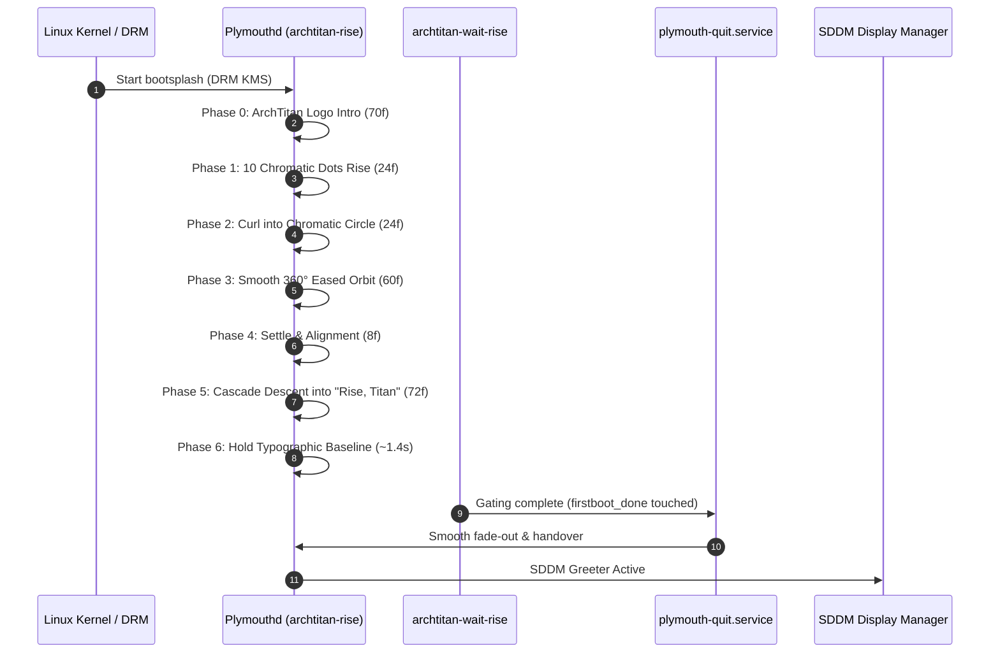
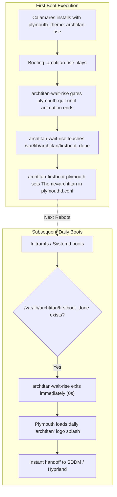

# ArchTitan Boot Ceremony & Splash

ArchTitan OS provides a custom, two-tier Plymouth boot experience engineered for high-impact initial impressions and instant daily boot times:

1. **"Rise, Titan." First-Boot Ceremony (`archtitan-rise`)** — An exclusive, cinematic one-shot boot ceremony that plays on the user's very first boot following installation.
2. **Daily Boot Splash (`archtitan`)** — A lightweight, minimalist ArchTitan logo splash featuring an ambient glow and zero delay (`ShowDelay=0`) for daily startups into SDDM and Hyprland.

---

## 1. "Rise, Titan." First-Boot Ceremony

### Visual Architecture & Motion Design

- **Chromatic Glowing Particle Orbs**: Rather than generic flat dots, the ceremony utilizes 10 bespoke high-precision glowing orbs (`dot_c0.png` through `dot_c9.png`) calibrated to match the exact hex palette and luminance of each corresponding letter:
  - **Dot 0 ('R')**: Titanium Ice White (`#F5F7FF`)
  - **Dot 1 ('i')**: Laser Cyan (`#00D2FF` / ArchTitan Accent)
  - **Dot 2 ('s')**: Precision Sapphire (`#0284C7` / Accent 2)
  - **Dot 3 ('e')**: Lavender (`#9C8CFF`)
  - **Dot 4 (',')**: Soft Violet (`#BD88FF`)
  - **Dot 5 ('T')**: Titanium Ice White (`#F5F7FF`)
  - **Dot 6 ('i')**: Laser Cyan (`#00D2FF`)
  - **Dot 7 ('t')**: Precision Sapphire (`#0284C7`)
  - **Dot 8 ('a')**: Lavender (`#9C8CFF`)
  - **Dot 9 ('n')**: Titanium Ice White (`#F5F7FF`)
- **True Typographic Baseline Alignment**: Uses an internal canvas baseline mapping table (`ink_bottom[0..9]`) to ensure all lowercase letters, capitals, and punctuation align flat on a single typographic baseline (`slot_y`) with uniform scaling (`ink_w * scale`).
- **Precision Fall Physics**: Eliminates cartoon bouncing ball arcs in favor of a smooth cubic ease-out descent (`ease_out(lt)`) with a seamless cross-fade from glowing particle orb into the letterform during the landing window.
- **Clean Floating Geometry**: The circular orbit is completely decoupled from artificial horizon lines, providing a clean, floating aesthetic against the radial dark violet/blue background.
- **Interactive Skip**: Clicking the mouse or pressing any keyboard key triggers an immediate 20-frame smooth fade-out directly to SDDM.

---

## 2. Atomic One-Shot Retirement Architecture

To ensure the first-boot ceremony plays smoothly and **never leaks into daily boots**, ArchTitan uses a two-service state machine:

### Components

1. **`archtitan-wait-rise` (`/usr/local/bin/archtitan-wait-rise`)**:
   - Installed as an `ExecStartPre` drop-in in `/etc/systemd/system/plymouth-quit.service.d/archtitan-rise-wait.conf`.
   - On first boot, blocks `plymouth-quit.service` until `plymouthd` completes the ceremony naturally (or the 16-second safety timeout elapses).
   - Writes `/var/lib/archtitan/firstboot_done` immediately upon completion.
   - On all subsequent boots, detects `firstboot_done` and exits immediately (0-second no-op).

2. **`archtitan-firstboot-plymouth` (`/usr/local/bin/archtitan-firstboot-plymouth`)**:
   - Enabled as a systemd service (`archtitan-firstboot-plymouth.service`) ordered before `sysinit.target`.
   - Bypasses live ISO environments (`/run/archiso`).
   - Sets `/var/lib/archtitan/firstboot_done` and permanently writes `Theme=archtitan` to `/etc/plymouth/plymouthd.conf`.
   - Triggers an asynchronous background initramfs update (`plymouth-set-default-theme archtitan`) without blocking boot execution.

---

## 3. Daily Boot Splash (`archtitan`)

On all daily boots, ArchTitan uses the standard `archtitan` theme:
- Located at `/usr/share/plymouth/themes/archtitan/`.
- Configured with `ShowDelay=0` and `DeviceTimeout=5` in `/etc/plymouth/plymouthd.conf`.
- Displays the ArchTitan emblem with an illuminated laser-cyan ambient glow and a minimal progress indicator.
- Automatically transitions into SDDM and the Hyprland desktop environment.

---

## File & Configuration Locations

| Component | Path | Description |
| :--- | :--- | :--- |
| **Rise Theme Script** | `/usr/share/plymouth/themes/archtitan-rise/archtitan-rise.script` | Plymouth script governing animation timeline and canvas math |
| **Rise Assets** | `/usr/share/plymouth/themes/archtitan-rise/assets/` | Glyphs (`glyph_c0..c9`), chromatic dots (`dot_c0..c9`), and background |
| **Daily Theme** | `/usr/share/plymouth/themes/archtitan/archtitan.plymouth` | Daily logo bootsplash definition |
| **Firstboot Marker** | `/var/lib/archtitan/firstboot_done` | One-shot state sentinel |
| **Wait Gate Helper** | `/usr/local/bin/archtitan-wait-rise` | `ExecStartPre` gating script for `plymouth-quit.service` |
| **Theme Switcher** | `/usr/local/bin/archtitan-firstboot-plymouth` | Service script managing daily theme reversion |
| **Daemon Config** | `/etc/plymouth/plymouthd.conf` | Active Plymouth daemon configuration |
