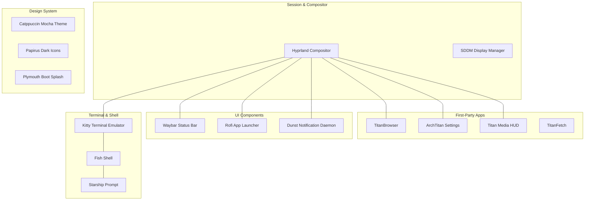

# Desktop Environment

ArchTitan OS delivers a Wayland-native desktop built around the **Hyprland** dynamic tiling window manager, unified visually with the **Catppuccin Mocha** dark palette and enhanced by first-party Qt6 desktop applications.

---

## Ecosystem Breakdown



---

## Desktop Components & Configurations

| Component | Function | Configuration File Location |
| :--- | :--- | :--- |
| **Hyprland** | Wayland Tiling Compositor (v0.53+/v0.56+ Lua & block syntax) | `~/.config/hypr/hyprland.lua` (falls back to `.conf` if absent) |
| **Waybar** | Top dark-pill status panel with center media capsule & THM badge | `~/.config/waybar/config` & `style.css` |
| **Titan Spotlight** | macOS-style native app launcher, instant calculator & search modal | `subsystems/titan-spotlight/` (`titan-spotlight`) |
| **Titan Menu** | Native Wayland layer-shell command palette & shortcuts cheat sheet | `subsystems/titan-menu/` (`titan-menu`) |
| **Titan Workspace HUD** | 10-Workspace interactive Mission Control overlay | `subsystems/titan-workspace-hud/` (`titan-workspace-hud`) |
| **Titan Quick Settings** | Obsidian glassmorphic control drawer & notification center | `subsystems/titan-quicksettings/` (`titan-quicksettings`) |
| **Titan Media HUD** | Dynamic Island overlay & playback controller | `subsystems/titan-media-hud/` (`titan-media-hud`) |
| **Titan Power Menu** | Native C++/Qt6 glass session & power overlay (Lock, Sleep, Logout, Reboot, Shutdown) | `subsystems/titan-powermenu/` (`titan-powermenu`) |
| **Titan System Monitor** | Hardware telemetry, GPU/CPU gauges, thermal state | `subsystems/titan-sysmon/` (`titan-sysmon`) |
| **TitanBrowser** | First-party Qt6 WebEngine browser | `titan-browser-source/` (`titanbrowser`) |
| **ArchTitan Settings** | System configuration GUI | `archtitan-settings/` |
| **SwayNC** | Lightweight Wayland notification daemon backend | `~/.config/swaync/` |
| **Kitty** | GPU-accelerated terminal emulator | `~/.config/kitty/kitty.conf` |
| **Fish Shell** | Interactive shell with auto-suggestions & syntax highlighting | `~/.config/fish/config.fish` |
| **Starship** | Cross-shell developer prompt | `~/.config/starship.toml` |

---

## Essential Keybindings Reference

All keybindings use the **Super** key (Windows/Cmd key) as the primary modifier:

### 1. System Overlays & Launchers

| Keybinding | Action | Command / Target |
| :--- | :--- | :--- |
| <kbd>Super</kbd> *(Single Tap)* | Open **Titan Spotlight** (macOS-style Search, Calculator & Launcher) | `titan-spotlight --toggle` |
| <kbd>Super</kbd> + <kbd>Space</kbd> | Open **ArchTitan Menu** (Central Command Palette) | `titan-menu --toggle` |
| <kbd>Super</kbd> + <kbd>K</kbd> | **Shortcuts & Command Palette** | `titan-menu --toggle` |
| <kbd>Super</kbd> + <kbd>Tab</kbd> | Toggle **Titan Workspace HUD** (10-Workspace Mission Control Grid) | `titan-workspace-hud --toggle` |
| <kbd>Super</kbd> + <kbd>N</kbd> | **Quick Settings & Notification Center** | `titan-quicksettings --toggle` |
| <kbd>Super</kbd> + <kbd>M</kbd> | **Media Island HUD Overlay** | `titan-media-hud --toggle` |
| <kbd>Super</kbd> + <kbd>\\</kbd> or <kbd>Super</kbd> + <kbd>Shift</kbd> + <kbd>\\</kbd> | **Wallpaper Picker** | `titan-wallpaper-picker` |
| <kbd>Super</kbd> + <kbd>V</kbd> | Open **Spotlight Clipboard History Manager** | `titan-spotlight --clipboard` |
| <kbd>Super</kbd> + <kbd>Escape</kbd> | Open **Titan Power Menu** | `titan-powermenu --toggle` |

### 2. Applications

| Keybinding | Action | Command |
| :--- | :--- | :--- |
| <kbd>Super</kbd> + <kbd>Return</kbd> | Kitty Terminal | `kitty` |
| <kbd>Super</kbd> + <kbd>W</kbd> | Default Web Browser | `titanbrowser` |
| <kbd>Super</kbd> + <kbd>E</kbd> | Ranger File Manager | `kitty -e ranger` |
| <kbd>Super</kbd> + <kbd>C</kbd> | Code Editor | `code` (VS Code) |
| <kbd>Super</kbd> + <kbd>X</kbd> | Terminal Text Editor | `kitty -e nano` |
| <kbd>Super</kbd> + <kbd>,</kbd> *(comma)* | **ArchTitan Settings Panel** | `archtitan-settings` |
| <kbd>Super</kbd> + <kbd>I</kbd> | Calamares Installer *(Live ISO)* / Settings *(Installed)* | `launch-installer` / `archtitan-settings` |
| <kbd>Ctrl</kbd> + <kbd>Super</kbd> + <kbd>V</kbd> | Audio Mixer | `pavucontrol` |
| <kbd>Ctrl</kbd> + <kbd>Shift</kbd> + <kbd>Esc</kbd> | Task Manager | `kitty -e btop` |

### 3. Screen Capture & Tools

| Keybinding | Action | Command |
| :--- | :--- | :--- |
| <kbd>Super</kbd> + <kbd>Shift</kbd> + <kbd>S</kbd> | Interactive Region Screenshot to Clipboard | `grim -g "$(slurp)" - \| wl-copy` |
| <kbd>Print</kbd> | Interactive Region Screenshot to Clipboard | `grim -g "$(slurp)" - \| wl-copy` |

### 4. Window Management & Tiling

| Keybinding | Action |
| :--- | :--- |
| <kbd>Super</kbd> + <kbd>Q</kbd> | Close active window |
| <kbd>Super</kbd> + <kbd>Shift</kbd> + <kbd>Alt</kbd> + <kbd>Q</kbd> | Forcefully kill focused window (`hyprctl kill`) |
| <kbd>Super</kbd> + <kbd>Alt</kbd> + <kbd>Space</kbd> | Toggle Floating / Tiling mode |
| <kbd>Super</kbd> + <kbd>F</kbd> | Toggle Fullscreen mode |
| <kbd>Super</kbd> + <kbd>D</kbd> | Toggle Maximized mode (fullscreen with desktop gaps) |
| <kbd>Super</kbd> + <kbd>P</kbd> | Toggle Pseudo-tiling mode (dwindle layout) |
| <kbd>Super</kbd> + <kbd>J</kbd> | Toggle split orientation (horizontal vs vertical) |
| <kbd>Super</kbd> + <kbd>←</kbd> / <kbd>→</kbd> / <kbd>↑</kbd> / <kbd>↓</kbd> | Move focus Left / Right / Up / Down |
| <kbd>Super</kbd> + <kbd>Shift</kbd> + <kbd>←</kbd> / <kbd>→</kbd> / <kbd>↑</kbd> / <kbd>↓</kbd> | Move window position Left / Right / Up / Down |
| <kbd>Super</kbd> + Left Click Drag | Move floating window |
| <kbd>Super</kbd> + Right Click Drag | Resize floating window |

### 5. Workspaces & Scratchpad

| Keybinding | Action |
| :--- | :--- |
| <kbd>Super</kbd> + <kbd>1</kbd> .. <kbd>9</kbd> | Switch directly to Workspace 1 .. 9 |
| <kbd>Super</kbd> + <kbd>Shift</kbd> + <kbd>1</kbd> .. <kbd>9</kbd> | Move active window to Workspace 1 .. 9 |
| <kbd>Ctrl</kbd> + <kbd>Super</kbd> + <kbd>←</kbd> / <kbd>→</kbd> | Switch to Previous / Next workspace |
| <kbd>Super</kbd> + <kbd>Page_Up</kbd> / <kbd>Page_Down</kbd> | Switch to Previous / Next workspace |
| <kbd>Super</kbd> + Mouse Scroll | Cycle through active workspaces |
| <kbd>Super</kbd> + <kbd>S</kbd> | Toggle Scratchpad / Special workspace (`special:magic`) |
| <kbd>Super</kbd> + <kbd>Alt</kbd> + <kbd>S</kbd> | Move focused window into Scratchpad |

### 6. Session & Power

| Keybinding | Action |
| :--- | :--- |
| <kbd>Ctrl</kbd> + <kbd>Alt</kbd> + <kbd>Delete</kbd> | Open **Titan Power Menu** (`titan-powermenu`) |
| <kbd>Super</kbd> + <kbd>L</kbd> | Lock screen (`hyprlock` / `swaylock`) *(disabled on live ISO)* |
| <kbd>Super</kbd> + <kbd>Shift</kbd> + <kbd>L</kbd> | Suspend / Sleep system (`systemctl suspend -i`) |

### 7. Touchpad Gestures

| Gesture | Action |
| :--- | :--- |
| **3-Finger Horizontal Swipe** | Workspace slide (1:1 continuous trackpad swipe) |
| **3-Finger Swipe Down** | Close active window |
| **3-Finger Swipe Up** | Open App Overview / Search |
| **4-Finger Swipe Up** | Toggle Scratchpad (`special:magic`) |
| **4-Finger Swipe Down** | Show Desktop (toggle `showdesktop` special workspace) |

### 8. Hardware & Media Keys

| Key | Action | Command |
| :--- | :--- | :--- |
| <kbd>XF86AudioPlay</kbd> | Play / Pause playback | `playerctl play-pause` |
| <kbd>XF86AudioNext</kbd> | Next audio track | `playerctl next` |
| <kbd>XF86AudioPrev</kbd> | Previous audio track | `playerctl previous` |
| <kbd>XF86AudioRaiseVolume</kbd> | Volume Up (+5%) | `wpctl set-volume @DEFAULT_AUDIO_SINK@ 5%+` |
| <kbd>XF86AudioLowerVolume</kbd> | Volume Down (-5%) | `wpctl set-volume @DEFAULT_AUDIO_SINK@ 5%-` |
| <kbd>XF86AudioMute</kbd> | Toggle Audio Mute | `wpctl set-mute @DEFAULT_AUDIO_SINK@ toggle` |

---

### 9. Live ISO Key Behaviors

On live mkarchiso media (`/run/archiso`), specific key behaviors ensure a safe, frictionless test environment:
- **<kbd>Super</kbd> + <kbd>I</kbd>**: Dispatches `launch-installer` (Calamares GUI) with proper Wayland root socket permissions, rather than opening settings.
- **<kbd>Super</kbd> + <kbd>L</kbd>**: Explicitly disabled (`:`) on the live ISO to avoid locking users out of a session with an unknown password.
- **<kbd>XF86Sleep</kbd>**: Swallowed on the live ISO to prevent accidental suspend while evaluating or installing.
- **Sandbox Bypass**: App launches automatically bypass `titan-sandboxd` namespace wrapping on the live squashfs filesystem to prevent silent launch failures.

---

## Modern Hyprland Window Rules Syntax (v0.53+)

ArchTitan OS uses Hyprland v0.53+/v0.56+ named block syntax for window rules.
The block **must** start with `name`, and match props use the `match:<prop>`
form (a nested `match { ... }` block is not valid):

```ini
# Calamares installer window rule block
windowrule {
    name = calamares-rule
    match:class = ^(calamares)$
    float = true
    center = true
}
```

Validate config changes before rebooting:

```bash
Hyprland --verify-config -c ~/.config/hypr/hyprland.lua
```

### VM Rendering Flags (Aquamarine Backend)

For QEMU, VirtualBox, and virtualized GPU environments running Hyprland 0.56+:

```ini
env = AQ_NO_MODIFIERS,1

cursor {
    no_hardware_cursors = true
}
```

---

## Catppuccin Mocha Theme Specification

ArchTitan OS enforces the Catppuccin Mocha color palette across all applications:

```
Base      : #1e1e2e  (Background)
Mantle    : #181825  (Darker background)
Crust     : #11111b  (Deepest dark)
Text      : #cdd6f4  (Primary text)
Subtext0  : #a6adc8  (Secondary text)
Blue      : #89b4fa  (Accent primary)
Lavender  : #b4befe  (Accent secondary)
Sapphire  : #74c7ec  (Active window border gradient 1)
Teal      : #94e2d5  (Active window border gradient 2)
Red       : #f38ba8  (Error / urgent)
Green     : #a6e3a1  (Success / active state)
```

### Window Decoration Settings

- **Border Width**: `2px`
- **Active Border**: `gradient(45deg, 0xff74c7ec, 0xff94e2d5)`
- **Inactive Border**: `0xff313244`
- **Corner Rounding**: `10px`
- **Blur**: Enabled (`size = 6`, `passes = 2`, `new_optimizations = true`)
- **Drop Shadow**: Enabled (`range = 15`, `render_power = 3`)
- **Animations**: Overshot spring curve (`bezier = overshot, 0.05, 0.9, 0.1, 1.05`)

---

## Redesigned Waybar & Dynamic Island Integration

Waybar features a dark pill design language matching the technical Linux aesthetic:

- **Blue Active Workspace Pill**: Highlighted capsule indicating the active Hyprland workspace.
- **Center Media Capsule Trigger**: Interactive central module that displays current media/audio track and triggers the **Titan Media HUD** Dynamic Island overlay when clicked.
- **THM Workload Badge**: Displays current workload profile (`[SYS]`, `[WEB]`, `[AND]`, `[CAS]`) in vibrant accent colors.
- **Hardware Telemetry**: Displays live CPU usage %, RAM consumption %, CPU temperature, and active PipeWire volume level.
