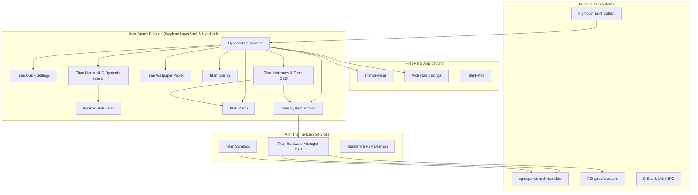

# ArchTitan OS Wiki

Welcome to the ArchTitan OS documentation. This wiki covers everything from building the live ISO to configuring the custom daemons, first-party applications, and Wayland LayerShell desktop interfaces that make ArchTitan a high-performance distribution.

> **Project status:** Active production development. Core ISO build pipeline, THM daemon (v3.9), Titan Sandbox, TitanFetch, TitanBrowser, ArchTitan Settings, Titan Media HUD, Titan Quick Settings, Titan Menu, Titan System Monitor, Titan Tour v2, Titan Hotzones, Titan Wallpaper Picker, and Plymouth "Rise, Titan." boot ceremony are shipped in the production ISO. Group subsystems (Auto GPU Switcher, TITAN AI, TITAN Task Manager, TITAN Share, TITAN Mirror) are structured under `subsystems/`.

---

## What is ArchTitan?

ArchTitan is a custom, developer-focused Linux distribution built on [Arch Linux](https://archlinux.org) using [archiso](https://wiki.archlinux.org/title/Archiso). It ships a Wayland-native Hyprland desktop, first-party system services written in modern C++ (C++17 for THM, C++20 for Qt6 services), native Qt6 LayerShell applications (Titan Quick Settings, Titan Menu, Titan System Monitor, Titan Tour, Titan Media HUD), and a curated toolchain for software development — without the idle overhead of a full GNOME or KDE stack.

The project was originally developed as **TitanArch**, an advanced Final Year Project focused on autonomous context-aware resource management for developer workflows.

---

## Quick Links

| Topic | Page |
| :--- | :--- |
| System design & layers | [Architecture](Architecture) |
| Build a bootable ISO | [Building the ISO](Building-the-ISO) |
| Install to disk or VM | [Installation Guide](Installation-Guide) |
| First-boot animation & Plymouth splash | [Boot Ceremony & Splash](Boot-Ceremony-and-Splash) |
| Interactive welcome walkthrough | [Titan Tour v2](Titan-Tour) |
| Pointer dwell zones & edge gestures | [Titan Hotzones & Zone OSD](Titan-Hotzones) |
| Fluid desktop wallpaper manager | [Titan Wallpaper Picker](Titan-Wallpaper-Picker) |
| Resource orchestration daemon | [Titan Hardware Manager](Titan-Hardware-Manager) |
| Hardware telemetry & gauges sidebar | [Titan System Monitor](Titan-Sysmon) |
| Quick settings & notifications drawer | [Titan Quick Settings](Titan-QuickSettings) |
| Central command palette & shortcuts | [Titan Menu](Titan-Menu) |
| Dynamic Island overlay & media HUD | [Titan Media HUD](Titan-Media-HUD) |
| Per-app sandboxing | [Titan Sandbox](Titan-Sandbox) |
| Peer-to-peer file transfer | [Titan Share](Titan-Share) |
| System info CLI/GUI | [TitanFetch](TitanFetch) |
| First-party WebEngine browser | [Titan Browser](Titan-Browser) |
| System control center | [ArchTitan Settings](ArchTitan-Settings) |
| Hyprland, Waybar, keybindings | [Desktop Environment](Desktop-Environment) |
| Repo layout & contributing | [Developer Guide](Developer-Guide) |
| What's done vs planned | [Roadmap & Status](Roadmap-and-Status) |
| Common issues & troubleshooting | [Troubleshooting](Troubleshooting) |

---

## Core Philosophy

1. **Wayland native** — Hyprland compositor with Wayland LayerShell surfaces; zero legacy X11 session dependencies.
2. **Autonomous resource awareness** — Titan Hardware Manager (THM v3.10) uses cgroups v2, kernel PSI, and multi-signal classification to keep foreground workflows jitter-free.
3. **First-party desktop stack** — Native C++/Qt6 desktop suite (TitanBrowser, Settings, Quick Settings, Menu, System Monitor, Media HUD, Hotzones, Wallpaper Picker).
4. **Cinematic polish & aesthetic cohesion** — Catppuccin Mocha theme, custom Plymouth "Rise, Titan." boot ceremony, and consistent Obsidian glassmorphism.
5. **Developer ready** — Fish + Starship shell, VS Code, Docker, Rust/Go/Node toolchains, and Android tooling hooks pre-installed out of the box.

---

## System at a Glance



---

## Getting Started

### Try the live ISO

1. [Build the ISO](Building-the-ISO) on an Arch Linux host, or download a release when available.
2. Flash to USB and boot in **UEFI** mode.
3. Explore the live Hyprland desktop, then press **Super + I** to launch Calamares.

### Test in a VM

Use the included QEMU helper:

```bash
./run-vm.sh          # boot ISO
./run-vm.sh --disk   # boot installed qcow2
./run-vm.sh --fresh  # wipe disk + reinstall
```

See [Installation Guide → Virtual Machines](Installation-Guide#virtual-machines) for VirtualBox and QEMU details.

---

## External Resources

- [GitHub Repository](https://github.com/GitGuru29/archtitan-os)
- [Arch Linux Wiki](https://wiki.archlinux.org/)
- [Hyprland Wiki](https://wiki.hypr.land/)
- [archiso Documentation](https://wiki.archlinux.org/title/Archiso)

---

## License

ArchTitan project files are MIT-licensed. Arch Linux and bundled third-party software retain their respective licenses.
