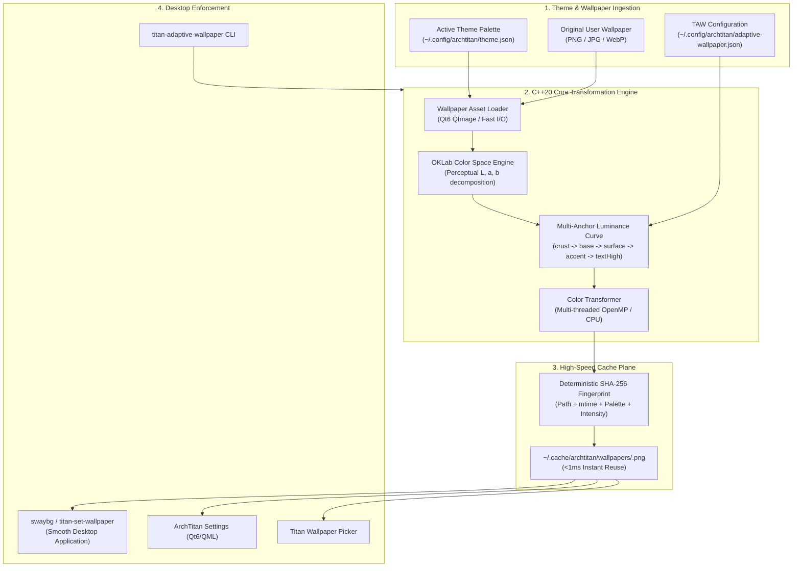

# Titan Adaptive Wallpaper (TAW)

**Titan Adaptive Wallpaper (TAW)** is a native ArchTitan OS subsystem that automatically adapts the visual color atmosphere of the active desktop wallpaper to complement the currently selected desktop theme.

The core principle:
> **One original wallpaper &rarr; Multiple theme-aware visual appearances &rarr; Automatic synchronization.**

When a user switches themes (e.g. from Catppuccin Mocha to Nord, Everforest, or Dracula), the wallpaper dynamically shifts its color palette without changing the original composition, blowing out highlights, or degrading image quality. The original wallpaper image remains 100% untouched.

---

## Key Features

- **Automatic Theme Detection & Synchronization**: Reacts to active desktop theme changes triggered via `titan-theme`, QuickSettings, or ArchTitan Settings.
- **Selective Color Mapping & Luminance Preservation**: Converts pixels to the **OKLab** perceptual color space to preserve original contrast, shadows, and natural highlights while smoothly transitioning color tones into the active theme palette.
- **Spec-Clean Whites & Deep Blacks**: Specular highlights ($L > 0.92$) and deep shadow blacks are protected from unnatural tinting.
- **High-Performance Deterministic Cache**: Generated wallpaper variants are hashed (SHA-256) and cached under `~/.cache/archtitan/wallpapers/`. Cache hits execute in **< 1 ms** with zero CPU overhead.
- **Manual Intensity & Palette Overrides**: Users can adjust adaptation intensity (from 0% untouched to 100% full adaptation) or pin a custom palette independently of the active theme.
- **Native GUI & CLI Integration**: Fully controllable via ArchTitan Settings (`AppearancePage.qml`), the standalone CLI `titan-adaptive-wallpaper`, or the background daemon.

---

## Subsystem Architecture



---

## Theme Compatibility

TAW comes pre-configured with support for the primary ArchTitan desktop themes, while dynamically accepting any custom JSON palette:

| Theme | Characteristic Atmosphere & Palette |
| :--- | :--- |
| **Catppuccin Mocha** | Lavender, purple, deep sapphire blue (`#89B4FA`, `#CBA6F7`) |
| **Nord** | Arctic frost blue, icy cyan (`#88C0D0`, `#81A1C1`) |
| **Tokyo Night** | Neon electric blue, violet (`#7AA2F7`, `#BB9AF7`) |
| **Dracula** | Midnight purple, magenta (`#BD93F9`, `#FF79C6`) |
| **Gruvbox** | Warm amber, earthy orange (`#FE8019`, `#FABD2F`) |
| **Everforest** | Forest green, muted sage teal (`#A7C080`, `#83C092`) |
| **Rosé Pine** | Dusty rose, soft mauve (`#EB6F92`, `#C4A7E7`) |
| **AMOLED** | Pure black shadow crush (`#000000`), electric cyan highlights |

---

## Configuration (`~/.config/archtitan/adaptive-wallpaper.json`)

```json
{
  "enabled": true,
  "autoSync": true,
  "intensity": 0.70,
  "originalWallpaper": "/usr/share/backgrounds/archtitan/wallpaper.png",
  "activeThemeId": "mocha",
  "manualPaletteOverride": "",
  "lastAdaptedWallpaper": "/home/user/.cache/archtitan/wallpapers/a3f1...e9.png"
}
```

---

## Command-Line Usage

The `titan-adaptive-wallpaper` utility provides comprehensive controls:

```bash
# Check current adaptive wallpaper state and cache metrics
titan-adaptive-wallpaper status

# Manually trigger a synchronization with the active theme
titan-adaptive-wallpaper sync --force

# Transform an arbitrary wallpaper image with a specific palette
titan-adaptive-wallpaper transform ~/Pictures/mountain.jpg --theme nord --intensity 0.75 --output ~/Pictures/mountain_nord.png

# Update the global adaptation intensity (0.0 to 1.0)
titan-adaptive-wallpaper set-intensity 0.80

# Select a manual palette override (e.g. force Everforest regardless of theme)
titan-adaptive-wallpaper set-palette everforest

# Clear manual override and return to following system theme
titan-adaptive-wallpaper set-palette none

# Temporarily restore the untouched original wallpaper
titan-adaptive-wallpaper restore

# Clear the wallpaper cache
titan-adaptive-wallpaper cache-clear

# Run the live inotify theme watcher daemon
titan-adaptive-wallpaper daemon
```

---

## Performance & Invariants

1. **Sub-Millisecond Cache Hits**: Once an image is adapted for a theme, subsequent theme switches reuse the cached variant in **< 1 ms**.
2. **Untouched Original Assets**: Source wallpaper files are opened read-only.
3. **No UI Freezes**: Image transformations run multithreaded (OpenMP / QThreadPool) off the Wayland UI thread.
4. **Flicker-Free Transitions**: Applied via `titan-set-wallpaper` with graceful background process transitions.

