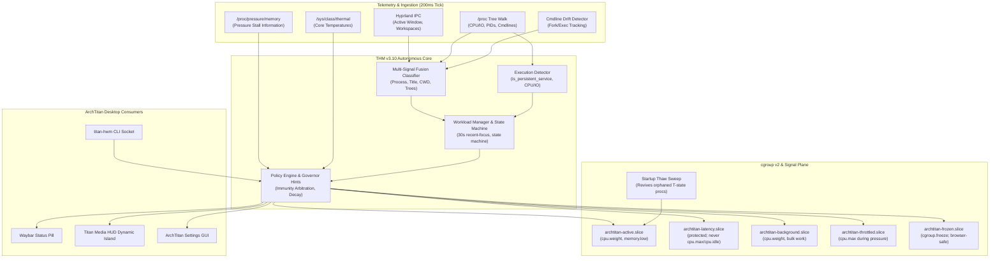
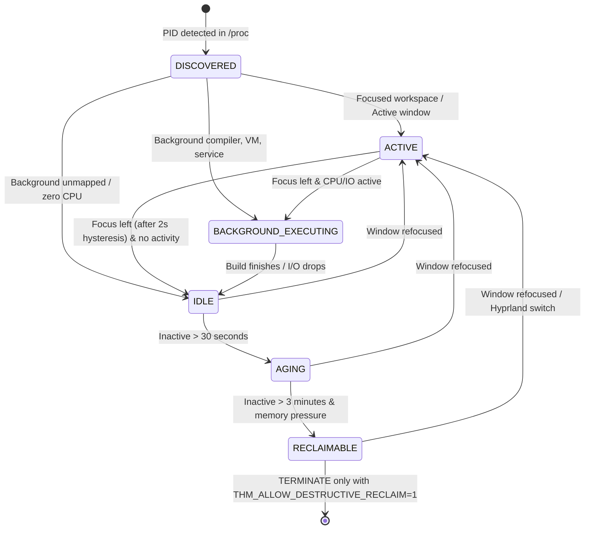

# Titan Hardware Manager (THM v3.10)

The **Titan Hardware Manager (`titan-hwm`)** is ArchTitan OS's flagship workload-centric resource orchestration daemon. Written in **C++17** for the daemon/core/CLI (the empirical bench harness is C++20), THM autonomously governs Linux kernel primitives—including **cgroups v2**, **Pressure Stall Information (PSI)**, process scheduling weights, and memory reclaim—by tracking real-time developer workflows across Wayland (Hyprland) workspaces.

Rather than relying on naive memory kill thresholds (`oomd`) or static governors, THM understands modern developer activities (compilers, language servers, persistent VMs, test runners, dev watchers, browser renderers, and audio daemons) and ensures foreground fluidity without disrupting long-running build tasks.

---

## Key Highlights & Capabilities

- **Workload Classification (Multi-Signal Fusion)**: Combines process tree walking, Hyprland window/workspace focus, CWD project signatures (`package.json`, `Cargo.toml`, `CMakeLists.txt`), GUI window titles, and dynamic cmdline drift detection. Since v3.9 the active Hyprland class/title is bound to the matching workload **root**; a title alone never binds a headless compiler.
- **cgroup v2 Resource Slices**: Dynamically routes processes across `archtitan-active.slice`, `archtitan-latency.slice`, `archtitan-background.slice`, `archtitan-throttled.slice`, and `archtitan-frozen.slice`. `archtitan-latency.slice` is never capped or idled.
- **CPU Guardrail (HC-CPU-1)**: CPU pressure changes scheduling only — no kill, stop, or freeze signal may originate from the CPU plane.
- **First-Class Service & VM Immunity**: Dedicated `WorkloadType::SERVICE` and `WorkloadType::VM` classifications guarantee databases, container runtimes, QEMU, and Android emulators are never frozen or killed.
- **Browser-Safe Enforcement**: Browser roots are marked latency-sensitive; background renderer processes are frozen exclusively via cgroups (`cgroup.freeze`), strictly bypassing POSIX signals to prevent UI deadlock.
- **Recent-Focus Context**: A bounded 30-second window keeps a just-left workspace foreground, preventing downgrades during rapid workspace switches.
- **Stall-Aware Bandwidth Loan (v3.8)**: Idle foreground reservation is lent to bulk work only after five quiet ticks; input, PSI stalls, or foreground growth reclaim it immediately.
- **Orphan Thaw Sweep**: On daemon startup, `startup_thaw_sweep()` scans `/proc` and automatically revives (`SIGCONT`) any user processes left suspended in `T` state by previous crashes or sessions.
- **Dependency Graph (v3.10)**: window-bound roots are linked to LSP/build children, shared-CWD processes, and ancestry; an active dependent blocks reclaim of its root even without a shared PID.
- **Rigorous Real-World Validation**: 100% pass rate across **49 architectural test cases** (TC-01 through TC-49) plus CPU headroom, cgroup RAM-pressure, and QEMU/KVM A/B benchmarks.

## Dependency Graph (v3.10)

The ownership forest answers “which workload owns this PID?”. The dependency
graph answers “which workload needs this root to stay alive?”. Edges are
directed `dependent -> provider` and are inferred from process ancestry,
LSP/build toolchain metadata, and shared project CWD under a Hyprland-bound
root. `ReclaimEngine` queries the graph before any memory reclaim signal, and
telemetry publishes providers, dependents, and `protected_by_dependents`.

Browser tab groups, `waits-on`, and reclassification history are not modelled
yet; current browser roots are shielded by the protected-root invariant.

---

## System Architecture & Control Loop

THM operates as an autonomous event loop ticking every **200 milliseconds** without blocking system call latency.



---

## Workload Classification Taxonomy

THM categorizes all system processes into specialized `WorkloadType` classifications to apply tailored scheduling and memory protection:

| Workload Type | Identified Binaries & Signatures | Policy & Protection Level |
| :--- | :--- | :--- |
| **`COMPILER`** | `gcc`, `clang`, `clang++`, `rustc`, `cargo`, `make`, `ninja`, `cmake` | **Highest priority**. Retains `ACTIVE` or `BACKGROUND_EXECUTING`; protected from freezing while compiling. |
| **`DEVELOPMENT_SERVICE`** | `vite`, `nodemon`, `webpack`, `next`, `tsc --watch`, `pytest`, `jest`, `vitest`, `mocha` | **Protected Background**. Retains execution status even during idle CPU periods between file-watch events. |
| **`SERVICE`** | `dockerd`, `containerd`, `podman`, `redis-server`, `mysqld`, `postgres`, `mongod`, `ollama` | **Freeze & Reclaim Immune**. Never migrated to reclaimable slice; never sent SIGSTOP. |
| **`VM`** | `qemu-system-*`, `libvirtd`, `virtlogd`, `firecracker`, `crosvm`, Android emulator | **Freeze Immune**. Retains background execution status; protected from suspension to prevent guest timer drift. |
| **`BROWSER`** | `titanbrowser`, `chromium`, `firefox`, `brave`, `chrome`, `zen-browser` | **Dual Tier**. Browser root marked latency-sensitive (`KEEP_BACKGROUND` minimum). Background renderers use cgroup freeze only. |
| **`TERMINAL`** | `kitty`, `alacritty`, `foot`, `wezterm` | **Interactive Foreground**. Immediate promotion upon workspace focus; inherits children build state. |
| **`MEDIA`** | `pipewire`, `wireplumber`, `spotify`, `mpv`, `vlc`, `rhythmbox` | **Audio Whitelist Immune**. Strictly excluded from freezing and OOM score escalation. |
| **`RUNTIME`** | `node`, `python`, `dotnet`, `java`, `ruby`, `go` | Contextual; classified via parent tree and active script arguments. |
| **`GUI_APP`** | General desktop applications | Governed by active window focus and workspace visibility. |

---

## cgroup v2 Slice Hierarchy

Under `/sys/fs/cgroup/`, THM provisions an isolated cgroup tree under `archtitan.slice`:

```
/sys/fs/cgroup/archtitan.slice/
├── archtitan-active.slice/
│   ├── cpu.weight = interactive policy
│   └── memory.low = protected foreground work
├── archtitan-latency.slice/
│   ├── protected from cpu.max / cpu.idle
│   └── latency-sensitive and GPU-feeding work
├── archtitan-background.slice/
│   ├── cpu.weight = throughput policy
│   └── bulk / observed work
├── archtitan-throttled.slice/
│   ├── cpu.max applied under CPU pressure
│   └── SMT-aware bandwidth loans may widen quota
└── archtitan-frozen.slice/
    ├── cgroup.freeze = 1 (browser-safe cgroup-only freeze)
    └── idle reclaim candidates only
```

### Architectural Differentiation from `systemd-oomd`

Traditional server daemons like `systemd-oomd` monitor pure memory pressure statistics in isolation, leading to destructive kills of heavy developer workloads (like an active 8-thread Rust compile or an Android emulator). 

THM solves this by coupling **cgroup PSI monitoring** with **compositor focus semantics**. No I/O or GPU control plane is implemented.
1. It knows which workspace you are looking at in Hyprland.
2. It protects child compilers spawned from background terminals if they are actively doing work.
3. It freezes non-critical background tabs and idle Electron wrappers before escalating to SIGTERM/SIGKILL.

---

## THM v3.10 Hardcore Resilience Matrix & 10h Stress-Test Remediations

THM v3.10 incorporates empirical architectural solutions developed to resolve 11 critical edge cases discovered during real-world stress testing, along with 7 major system-level remediations validated over 10-hour continuous stress runs:

| Category | Component | Failure Condition / Hazard | Architectural Remediation |
| :--- | :--- | :--- | :--- |
| **Safety** | `reclaim_engine` | SIGKILL escalation directly invoked `::kill()`, bypassing protected process guards during PID reuse. | Routed SIGKILL escalation strictly through protected-aware `kill_tree()`. Replaced `/proc` existence check with atomic `pidfd_open()` / `pidfd_send_signal()` to pin targeted processes. |
| **Performance** | `reclaim_engine` | `std::system()` invoked `/bin/sh` for process reclaims, spawning over 5,180 unnecessary shell forks. | Replaced `std::system()` with direct `posix_spawn()` execution from explicit `argv` arrays. |
| **Authority** | `workspace_monitor` | Build activities pinned CPU governor at max frequency indefinitely regardless of memory pressure. | Made system pressure authoritative over demand in `workspace_monitor` with asymmetric hysteresis. |
| **Cleanliness** | `workload_manager` | Zombie processes (`state == 'Z'`) passed `kill(p, 0) == 0` and un-reaped PIDs accumulated indefinitely. | Added `prune_dead_pids()` and zombie state eviction in `daemon.cpp`. |
| **Memory** | `fusion_classifier` | Unbounded static `s3_warned_cwds_` cache grew continuously over long daemon uptime. | Bounded cache to a maximum of 256 entries protected by mutex synchronization. |
| **Enforcement** | `cgroup_controller` | Subtree `cpu` controller missing in `archtitan.slice`, causing `cpu.weight` writes to silently fail. | Delegated `cpu` controller into `archtitan.slice` and added post-flush `f.good()` checks for write verification. |
| **Policy** | `policy_engine` | Latency-sensitive browser renderers overloaded `FREEZE` instead of reporting cgroup throttle state. | Implemented explicit `THROTTLE` policy return for latency-sensitive browser roots at `HIGH`. |

### Hardcore Edge-Case Failure Matrix (HC-01 through HC-11)

| Issue ID | Subsystem Component | Empirical Failure Condition | Current Architectural Solution |
| :--- | :--- | :--- | :--- |
| **HC-01** | `execution_detector` | DB daemons and local test servers went idle between queries and were mistakenly deprioritized. | Added `is_persistent_service()` to mark databases (`redis`, `postgres`, `mysql`, `mongod`) as permanently EXECUTING. |
| **HC-02** | `execution_detector` | Build watchers (`vite`, `nodemon`, `tsc --watch`) sleep on epoll and had CPU drop to 0%, getting marked IDLE. | Expanded `BUILD_CMDS` signature matching to recognize watch daemons as persistent build tasks. |
| **HC-03** | `daemon.cpp` | Headless processes (`workspace_id = -1`) mistakenly inherited the focused workspace ID. | Mapped headless and unmapped background processes to `workspace_id = -2` (background pool). |
| **HC-04** | `execution_detector` | Python/Node test runners (`pytest`, `jest`, `vitest`) during tear-down pauses were marked IDLE. | Added test runner patterns to active execution command table. |
| **HC-05** | `enforcement_plane` | Sending `SIGSTOP` to Chromium/Electron background renderers caused IPC pipe deadlocks. | Implemented cgroup-only freeze (`cgroup.freeze = 1`) for browser workloads, bypassing POSIX signals. |
| **HC-06** | `fusion_classifier` | Browser main root process dropped to IDLE/RECLAIMABLE when all windows were minimized. | Marked browser roots as `latency_sensitive = true`, enforcing a floor policy of `KEEP_BACKGROUND`. |
| **HC-07** | `policy_engine` | Container engines (`dockerd`, `podman`) got migrated to reclaimable slices during system RAM spikes. | Introduced `WorkloadType::SERVICE` with invariant immunity against freezing and reclaim. |
| **HC-08** | `policy_engine` | Android Studio QEMU emulators suspended during background IDE runs, corrupting guest timers. | Introduced `WorkloadType::VM` with invariant immunity against freezing. |
| **HC-09** | `workload_manager` | Rapid switching between Hyprland workspaces caused priority flapping and thrashing. | Introduced **2-second hysteresis** (10 ticks @ 200ms) on workspace exit before demotion. |
| **HC-10** | `daemon.cpp` | Process launched as shell (`bash`) executing a long compiler run was stuck with shell classification. | Implemented dynamic command-line drift detection to re-trigger classification on binary changes. |
| **HC-11** | `daemon.cpp` | Daemon restart left processes in POSIX `T` (stopped) state indefinitely. | Added `startup_thaw_sweep()` to automatically wake all user `T`-state processes with `SIGCONT` on boot. |

---

## Workload State Machine



---

## Audio Protection Whitelist

THM strictly isolates audio playback pipelines from suspension, deprioritization, and OOM scoring:

```
pipewire, pipewire-pulse, wireplumber, pulseaudio,
spotify, spotifyd, mpd, mpdris2, mpv, vlc,
rhythmbox, strawberry, deadbeef, cmus, ncmpcpp,
cantata, audacious, elisa, playerctld
```

Audio daemons and active players are protected from freeze and OOM-score escalation and are routed by latency policy.

---

## CLI & Control Reference (`titan-hwm`)

The daemon exposes an IPC UNIX domain socket at `/tmp/titan_hwm.sock` and writes live JSON telemetry to `/run/archtitan/thm-state.json`.

> **Note:** The v1/v2 concepts of "profiles" and the `titan-hwm switch` command were removed in v3. The daemon is fully autonomous — pressure is detected from PSI and memory and driven by the policy engine, not by a manually selected profile.

### CLI Commands

```bash
# Query current daemon state and workload allocations
titan-hwm status

# Display live terminal telemetry metrics (cgroups, PSI, active workloads)
titan-hwm metrics
```

### Telemetry State File (`/run/archtitan/thm-state.json`)

```json
{
  "version": "3.3.0",
  "timestamp_ms": 1792147312851,
  "uptime_seconds": 1420,
  "pressure": {
    "level": "NORMAL",
    "psi_some_avg10": 4.20,
    "psi_full_avg10": 0.00,
    "mem_used_pct": 38.67,
    "mem_total_kb": 16148320,
    "mem_available_kb": 9903324
  },
  "governor": "schedutil",
  "workload_count": 2,
  "cpu": {
    "pressure": "NORMAL",
    "psi_some_avg10": 2.10,
    "bandwidth_loan_cores": 0
  },
  "dependency": {
    "summary": "2 nodes, 1 edges (0 ancestry/1 toolchain/0 project, 1 shielded)",
    "nodes": 2,
    "edges": 1,
    "shielded": 1
  },
  "active_workloads": 0,
  "last_action": null,
  "workloads": [
    {
      "id": 2,
      "pid": 12844,
      "workspace": -2,
      "name": "cargo",
      "type": "SYSTEM_DEV",
      "state": "IDLE",
      "pids": 1,
      "window_class": "code",
      "window_title": "main.cpp - Visual Studio Code",
      "dependency_providers": 0,
      "dependency_dependents": 1,
      "protected_by_dependents": true
    }
  ]
}
```

---

## System Integration & Configuration

### File Locations

| Path | Purpose |
| :--- | :--- |
| `/usr/local/bin/titan-hwm-daemon` | C++17 autonomous resource orchestrator daemon executable |
| `/usr/local/bin/titan-hwm` | Native CLI interface for control and telemetry queries |
| `/usr/local/bin/titan-hwm-waybar` | Status pill helper script for Waybar UI integration |
| `/etc/titan-hwm/config` | Daemon configuration file (thresholds, tool whitelists, tier weights) |
| `/etc/systemd/system/archtitan.slice` | Systemd cgroup delegation slice (`Delegate=yes`) |
| `/etc/systemd/system/titan-hwm.service` | Hardened systemd unit with OOMScoreAdjust=-1000 and anti-tamper restart |
| `/tmp/titan_hwm.sock` | UNIX domain IPC socket |
| `/run/archtitan/thm-state.json` | Telemetry state JSON file (read by titan-sysmon, titanfetch, Waybar helpers) |

### Configuration File (`/etc/titan-hwm/config`)

```toml
# Titan Hardware Manager Config v3 (System Root-Owned)
debounce_ms = 800
ram_freeze_pct = 50
ram_kill_pct = 25
thermal_hot_temp = 80
oom_protect_score = -500
oom_expose_score = 500
sigterm_grace_ms = 500
casual_workspaces = [1]
web_workspaces = [2]
android_workspaces = [3]
system_workspaces = [4, 5]

[classifier]
lsp_binaries = ["clangd","ccls","rust-analyzer","tsserver","eslint_d"]
build_daemons = ["gradle","cargo","webpack","vite","java","cmake"]
ai_inference = ["ollama","llama-server","python3"]
known_ides = ["code","cursor","zed","windsurf","antigravity","fleet","idea","android-studio"]

[workspace_tiers]
active_ceiling = 0.70
active_reserve = 0.40
protected_reserve = 0.20
age_soft_decay_min = 5
age_hard_decay_min = 15

[multi_context]
lsp_protection = true
aggressive_swap = false
daemon_idle_cpu_pct = 0.5
daemon_idle_sample_ms = 30
```

### Build and Deployment

```bash
# Build daemon and test suite from source
cd titan-hwm-v3
cmake -B build -DCMAKE_BUILD_TYPE=Release
cmake --build build -j$(nproc)

# Run test suite
ctest --test-dir build --output-on-failure

# Install binaries and systemd units (or run ./install.sh from repo root)
sudo cp build/titan-hwm-daemon /usr/local/bin/titan-hwm-daemon
sudo cp archtitan.slice /etc/systemd/system/archtitan.slice
sudo cp titan-hwm.service /etc/systemd/system/titan-hwm.service
sudo systemctl daemon-reload
sudo systemctl enable --now titan-hwm.service
```

---

## Standalone Test Suite & Source Verification

THM v3.10 is verified using an independent, auditable test harness:

- **Standalone Test Repository**: [`https://github.com/GitGuru29/titan-hardware-manager-test-system`](https://github.com/GitGuru29/titan-hardware-manager-test-system)
- **Source Code in OS Repo**: `titan-hwm-v3/` (subsystem in `archtitan-os`)
- **Systemd Service**: `titan-hwm.service` (`/etc/systemd/system/titan-hwm.service`)
- **Binary Target**: `/usr/local/bin/titan-hwm-daemon` and `/usr/local/bin/titan-hwm`

