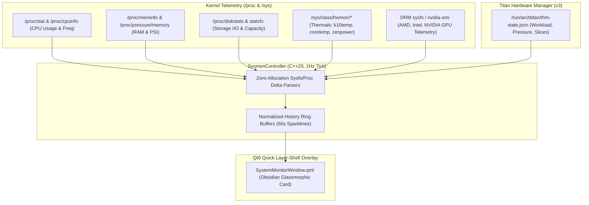

# Titan System Monitor (`titan-sysmon`)

The **ArchTitan System Monitor** (`titan-sysmon`) is a first-party, hardware-accelerated telemetry overlay and hardware inspection dashboard built with C++20 and Qt6 Quick / LayerShellQt. Designed specifically for developer workstations and performance monitoring, it delivers 1Hz real-time telemetry gauges and sparkline graphs with zero privileged helpers or external daemon dependencies.

Triggered via **`titan-sysmon --toggle`**, Waybar telemetry badge clicks, or through the **Titan Central Menu** under *Panels › System monitor*.

---

## Architecture & Data Sources

`titan-sysmon` samples live system state directly from the Linux kernel virtual filesystems and hardware interfaces:



---

## Monitored Telemetry Metrics

### 1. CPU Telemetry
- Total CPU utilization percentage and per-core utilization bars.
- Live scaling frequency (`cpufreq`) and maximum clock limits.
- 1-minute, 5-minute, and 15-minute load averages.
- 60-second real-time historical CPU load sparkline.

### 2. Memory & PSI Pressure
- Total, used, available, and cached physical memory (RAM in GB and %).
- Swap space utilization and pressure.
- Linux Kernel Pressure Stall Information (**PSI**): monitors memory stall percentages (`some` / `full`), surfacing workload contention before OOM killer events occur.
- 60-second RAM historical trend sparkline.

### 3. GPU Acceleration Telemetry
- Supports NVIDIA GPUs (via NVML / `nvidia-smi`) and AMD/Intel GPUs (via DRM sysfs).
- Reports GPU core clock, GPU memory utilization (VRAM), power draw in Watts, and engine utilization.

### 4. Thermals & Hardware Health
- Dynamic discovery of `/sys/class/hwmon/*` sensors across AMD `k10temp`/`zenpower`, Intel `coretemp`, `acpitz`, and discrete GPU nodes.
- Highlights package temperatures and warns when nearing thermal throttling thresholds.

### 5. THM v3 Workload State
- Integrates directly with the **Titan Hardware Manager** (`/run/archtitan/thm-state.json`).
- Shows the active workload profile (`DEV`, `BUILD`, `GAMING`, `IDLE`), assigned cgroup v2 slice shares, and system tier status.

---

## Layer-Shell Overlay Behavior

- **Positioning**: Anchored to the **Right**, **Top**, and **Bottom** margins on the active monitor output.
- **Glassmorphism**: Obsidian translucent backdrop matching the Catppuccin Mocha TDL palette with compositor blur (`layerrule = match:namespace titan-sysmon, blur on`).
- **Dismiss on Click-Away**: Features an intelligent grace-period dismiss handler—clicking outside the panel or pressing <kbd>Escape</kbd> smoothly closes the overlay without accidental triggers on opening.

---

## CLI & Daemon Interface

`titan-sysmon` runs as a single-instance daemon managed by Hyprland autostart:

```bash
# Start hidden daemon on login
titan-sysmon --daemon

# Toggle overlay visibility
titan-sysmon --toggle

# Explicit control
titan-sysmon --show
titan-sysmon --hide
```

---

## Directory & File Locations

- **Source Code**: [`subsystems/titan-sysmon/`](file:///home/msfvenom/custom-os-build/subsystems/titan-sysmon)
- **Binary**: `/usr/local/bin/titan-sysmon`
- **Permissions**: `0:0:755` (in `profiledef.sh`)
