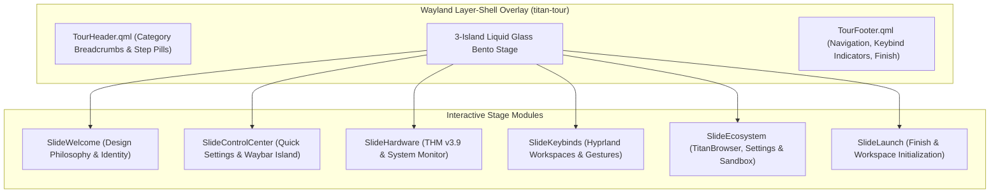

# Titan Tour v2 (`titan-tour`)

**Titan Tour v2** is ArchTitan OS's first-party, cinematic onboarding and interactive virtual tour application. Built with **C++20, Qt6 Quick, and LayerShellQt**, it welcomes new users upon initial login, introducing the Titan Design Language (TDL), keybindings, pointer hotzones, and the subsystem ecosystem through an interactive **Liquid Glass 3-island Bento stage**.

---

## Overview & Architecture



---

## Interactive Stages & Slides

1. **Welcome Stage (`SlideWelcome.qml`)**:
   - Introduces ArchTitan's core philosophy: a performance-first, context-aware developer distribution with low idle footprint.
   - Highlights the signature Catppuccin Mocha / Sapphire Liquid Glass styling.

2. **Control Center & Navigation (`SlideControlCenter.qml`)**:
   - Walks through **Titan Quick Settings** (<kbd>Super</kbd> + <kbd>N</kbd>) and the modular pill-based Waybar island.
   - Demonstrates quick toggles for Wi-Fi, Bluetooth, Audio output, and Power Profiles.

3. **Hardware Orchestration (`SlideHardware.qml`)**:
   - Showcases the **Titan Hardware Manager (THM v3.9)** and real-time telemetry streaming into the **Titan System Monitor** (`titan-sysmon`).
   - Explains cgroups v2 resource slicing (`archtitan-active.slice` vs. `archtitan-background.slice`).

4. **Keybindings & Gestures (`SlideKeybinds.qml`)**:
   - Interactive cheatsheet for essential Hyprland window tiling, workspace switching (<kbd>Super</kbd> + <kbd>1..9</kbd>), and 1:1 touchpad workspace swiping.
   - Pointer hotzones navigation (dwelling left-center edge to toggle System Monitor).

5. **Subsystem Ecosystem (`SlideEcosystem.qml`)**:
   - Highlights first-party tooling: **TitanBrowser**, **ArchTitan Settings**, **TitanFetch**, and **Titan Sandbox**.

6. **Launch Stage (`SlideLaunch.qml`)**:
   - Finalizes user profile configuration, writes the completion sentinel to `~/.config/archtitan/tour_done`, and transitions directly into the interactive Hyprland desktop.

---

## First-Run Trigger & Persistence

- **Autostart Trigger**: Configured in `/etc/skel/.config/hypr/hyprland.lua`. On initial user login, if `~/.config/archtitan/tour_done` is absent, `titan-tour` launches automatically.
- **Manual Launch**: Users can revisit the tour at any time via:
  ```bash
  titan-tour
  # Or with forced re-run
  titan-tour --force
  ```
- **CLI Flags**:
  - `--step <index>`: Jump directly to a specific slide (0 to 5).
  - `--test`: Run in a test window without saving the completion flag.

---

## File & Binary Locations

- **Source Code**: [`subsystems/titan-tour/`](file:///home/msfvenom/custom-os-build/subsystems/titan-tour)
- **Binary**: `/usr/local/bin/titan-tour`
- **Completion Flag**: `~/.config/archtitan/tour_done`
