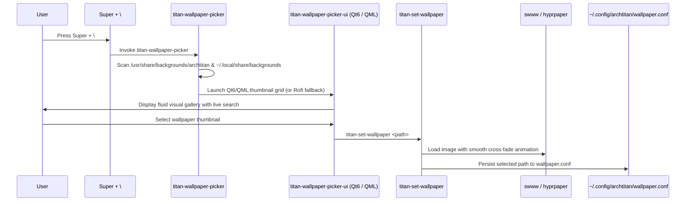

# Titan Wallpaper Picker

**Titan Wallpaper Picker** is the first-party visual wallpaper management suite in ArchTitan OS. It provides an instantaneous, fluid thumbnail browser for switching desktop backgrounds, paired with a persistence daemon that restores the active wallpaper on boot with smooth hardware-accelerated transitions.

---

## Architecture & Workflow



The suite consists of four complementary utilities:

| Binary / Script | Role |
| :--- | :--- |
| **`titan-wallpaper-picker`** | Entrypoint script bound to <kbd>Super</kbd> + <kbd>\\</kbd>. Scans wallpaper directories and delegates to the native UI or Rofi fallback. |
| **`titan-wallpaper-picker-ui`** | Native Qt6/QML graphical selector featuring fluid grid cards, active indicators, and Catppuccin Mocha glassmorphism. |
| **`titan-set-wallpaper`** | Applies the selected wallpaper image to active monitors via `swww` (with cross-fade transitions) or `hyprpaper`, and saves the path. |
| **`titan-wallpaper-restore`** | Executed once during Hyprland startup (`exec-once`) to read `wallpaper.conf` and restore the desktop background before windows render. |

---

## Keybindings

| Keybinding | Action | Command |
| :--- | :--- | :--- |
| <kbd>Super</kbd> + <kbd>\\</kbd> | Open Wallpaper Picker | `titan-wallpaper-picker` |
| <kbd>Super</kbd> + <kbd>Shift</kbd> + <kbd>\\</kbd> | Open Wallpaper Picker | `titan-wallpaper-picker` |

---

## Directory Hierarchy & Image Discovery

When launched, `titan-wallpaper-picker` scans the following locations for valid image formats (`.png`, `.jpg`, `.jpeg`, `.webp`, `.gif`):

1. **System Wallpapers**: `/usr/share/backgrounds/archtitan/`
   - Bundled system wallpapers, including official ArchTitan dark/light variants and Catppuccin aesthetic landscapes.
2. **User Wallpapers**: `~/.local/share/backgrounds/` (or `$XDG_DATA_HOME/backgrounds`)
   - Any images placed here by the user are automatically picked up and rendered in the gallery on the next launch.

---

## Persistence & Startup Restoration

When a wallpaper is selected:
1. `titan-set-wallpaper /path/to/image.png` is invoked.
2. The wallpaper path is written to:
   ```
   ~/.config/archtitan/wallpaper.conf
   ```
3. During Hyprland startup, `~/.config/hypr/hyprland.lua` executes:
   ```lua
   exec-once = titan-wallpaper-restore
   ```
4. If no user wallpaper has been selected, `titan-wallpaper-restore` falls back to the default system wallpaper at `/usr/share/backgrounds/archtitan/wallpaper.png`.

---

## Command-Line Usage

You can change or restore wallpapers directly from the terminal or shell scripts:

```bash
# Launch the graphical wallpaper picker
titan-wallpaper-picker

# Set a specific image file as wallpaper immediately
titan-set-wallpaper ~/Pictures/my-custom-wallpaper.png

# Re-apply the currently configured wallpaper (e.g. after monitor hotplug)
titan-wallpaper-restore
```
